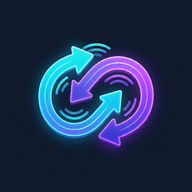
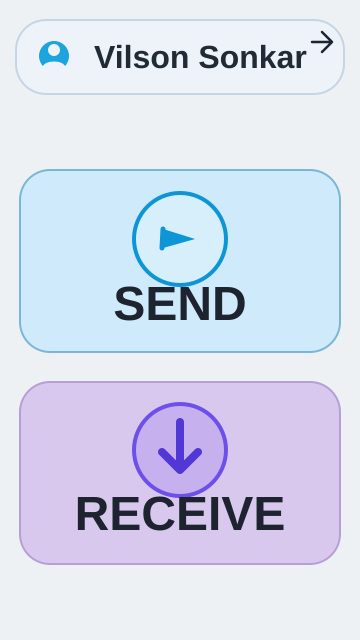
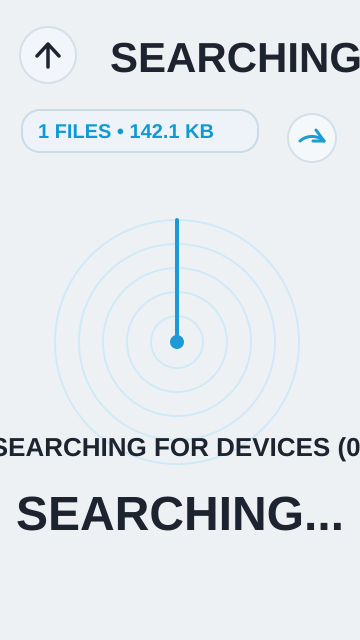
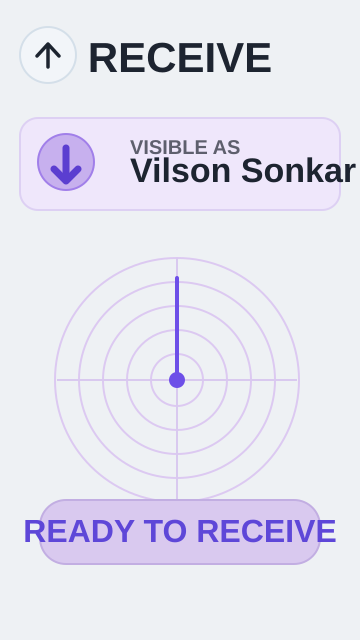

<p align="center">
  
</p>

<h1 align="center">Mini Share</h1>

<p align="center">
  <strong>Developer:</strong> Vilson Sonkar<br />
  <strong>Version:</strong> 1.0<br />
  <strong>Language:</strong> Kotlin
</p>

<p align="center">Offline, peer-to-peer file sharing between nearby Android devices using Wi-Fi Direct.</p>

## App Details

### Send
Choose files on your device, discover nearby peers, and send selected files directly to a connected device.

### Receive
Make your device visible to nearby Mini Share peers and get ready to receive incoming files. Received files are saved in the **Downloads/Mini Share** folder when supported by the device.

### Transfer
Track transfer progress, speed, and status for files as they move. Transfers use a direct socket connection between Wi-Fi Direct peers and support cancellation.

### Wi-Fi Direct
Discover nearby devices, connect without a router or internet connection, and create a local peer-to-peer link for sharing.

### P2P Sharing
Files are exchanged directly between the connected devices rather than uploaded to a cloud service. Bluetooth discovery helpers are also included in the app.

## Screenshots

<p align="center">
  
  
  
</p>

## Technology

- **Primary language:** Kotlin
- **UI:** Jetpack Compose and Material 3
- **Platform:** Android
- **Connectivity:** Android Wi-Fi Direct APIs, with Bluetooth discovery helpers
- **Minimum Android version:** Android 9 (API 28)

## Getting Started

1. Clone this repository and open it in Android Studio.
2. Allow Gradle to sync the project.
3. Connect an Android device that supports Wi-Fi Direct.
4. Build and run the `app` configuration.
5. Grant the requested nearby-device and file access permissions when prompted. Enable Wi-Fi and use the app's Send or Receive flow to find a peer.

## Project Structure

```text
app/src/main/java/com/example/
├── model/       # Transfer data models
├── p2p/         # Wi-Fi Direct management and Bluetooth discovery
├── transfer/    # File transfer engine
├── ui/          # Compose screens and components
└── viewmodel/   # App state and UI coordination
```

## Build Configuration

The Android app is configured with `minSdk 28`, `targetSdk 36`, and version `1.0`. See `app/build.gradle.kts` for the current Android build and dependency configuration.

## License

No license file is currently included in this repository. Please contact the project owner for licensing information before redistribution or reuse.
